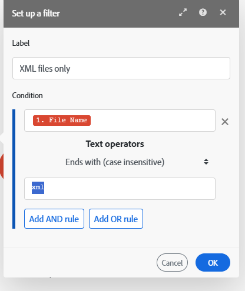

# 시나리오에 필터 추가

일부 시나리오에서는 특정 기준을 충족하는 번들로만 작업해야 합니다. 필터를 사용하여 해당 번들을 선택할 수 있습니다.

예를 들어 Workfront의 [!UICONTROL 레코드 보기] 트리거를 사용하여 특정 사용자에게 할당된 작업만 캡처하는 시나리오를 만들 수 있습니다.

두 모듈 사이에 필터를 추가하고 이전 모듈에서 받은 번들이 특정 필터 조건을 충족하는지 확인할 수 있습니다.

* 번들이 그러한 경우 시나리오의 다음 모듈로 전달됩니다.
* 그렇지 않으면 번들 처리가 종료됩니다.

>[!NOTE]
>
>Workfront Fusion에서 시나리오 편집기를 새 경험으로 전환합니다. 이 전환 중에 클래식 경험과 새 경험을 모두 사용할 수 있으며 언제든지 전환할 수 있습니다. 새 경험을 사용하는 것이 좋습니다. 자세한 내용은 문서 시나리오 편집기에서 [새 경험 및 클래식 경험](/help/workfront-fusion/get-started-with-fusion/navigate-fusion/scenario-editor.md#new-and-classic-experiences)을 참조하십시오.

## 액세스 요구 사항

+++ 이 문서의 기능에 대한 액세스 요구 사항을 보려면 확장하십시오.

<table style="table-layout:auto">
 <col> 
 <col> 
 <tbody> 
  <tr> 
   <td role="rowheader">Adobe Workfront 패키지</td> 
   <td> 
모든 Adobe Workfront 워크플로 패키지 및 모든 Adobe Workfront 자동화 및 통합 패키지

Workfront Ultimate

Workfront Prime 및 Select 패키지 및 Workfront Fusion 추가 구매.
 </td> 
  </tr> 
  <tr data-mc-conditions=""> 
   <td role="rowheader">Adobe Workfront 라이선스</td> 
   <td> 
표준

작업 이상
 </td> 
  </tr> 
  <tr> 
   <td role="rowheader">제품</td> 
   <td>
   
조직에 Workfront 자동화 및 통합이 포함되지 않은 Select 또는 Prime Workfront 패키지가 있는 경우 Adobe Workfront Fusion을 구매해야 합니다.</li></ul>
   </td> 
  </tr>
 </tbody> 
</table>

이 테이블의 정보에 대한 자세한 내용은 [설명서의 액세스 요구 사항](/help/workfront-fusion/references/licenses-and-roles/access-level-requirements-in-documentation.md)을 참조하십시오.

+++

## 전제 조건

두 모듈 사이에 필터를 추가하려면 먼저 두 모듈을 시나리오에 추가해야 합니다.

## 두 모듈 사이에 필터 추가

* [새 경험에서 두 모듈 사이에 필터 추가(권장)](#add-a-filter-between-two-modules-in-the-new-experience-recommended)
* [클래식 경험에서 두 모듈 사이에 필터 추가](#add-a-filter-between-two-modules-in-the-classic-experience)

### 새 경험에서 두 모듈 사이에 필터 추가(권장)

1. 왼쪽 패널의 **[!UICONTROL 시나리오]** 탭을 클릭합니다.
1. 필터를 추가할 시나리오를 선택합니다.
1. 시나리오의 아무 곳이나 클릭하여 시나리오 편집기를 입력합니다.
1. 필터를 추가할 모듈 사이의 경로를 마우스 왼쪽 단추로 클릭합니다.

   **[!UICONTROL 필터 설정]** 창이 바로 열립니다. 경로를 마우스 오른쪽 버튼으로 클릭하면 다른 메뉴가 대신 열립니다.

1. 표시되는 상자에 필터에 대한 **[!UICONTROL 레이블]**&#x200B;을 입력합니다.
1. 필터 **[!UICONTROL 조건]**&#x200B;을(를) 정의합니다.

   첫 번째 필드, 연산자 및 (필요한 경우) 필드를 비교할 값을 기준으로 필터링할 필드를 입력합니다.

   >[!TIP]
   >
   >매핑 패널에서 필터 필드에 값을 입력할 수 있습니다
   >매핑에 대한 자세한 내용은 [한 모듈에서 다른 모듈로 정보 매핑](/help/workfront-fusion/create-scenarios/map-data/map-data-from-one-to-another.md)을 참조하십시오.

   예를 들어 필터가 XML로 끝나는 Adobe Workfront의 파일을 전달하게 하려면 첫 번째 상자에 **[!UICONTROL 파일 이름]**&#x200B;을 입력하고 두 번째 상자에 .**[!UICONTROL xml]**&#x200B;을 입력합니다. 이 두 메뉴 사이의 드롭다운 메뉴에서 **[!UICONTROL 다음으로 끝남(대/소문자 구분 안 함)]**&#x200B;을 선택합니다. 이 필터는 첫 번째 모듈(Workfront)에서 들어오는 번들에 적용됩니다. XML 파일이 포함된 번들만 다음 모듈로 전달됩니다.

   

1. **[!DNL OK]**&#x200B;을(를) 클릭합니다.

### 클래식 경험에서 두 모듈 사이에 필터 추가

1. 왼쪽 패널의 **[!UICONTROL 시나리오]** 탭을 클릭합니다.
1. 필터를 추가할 시나리오를 선택합니다.
1. 시나리오의 아무 곳이나 클릭하여 시나리오 편집기를 입력합니다.
1. 필터를 추가할 모듈 사이에 있는 렌치 아이콘 을 클릭하고 **필터 설정**&#x200B;을 선택합니다.
1. 표시되는 상자에 필터에 대한 **[!UICONTROL 레이블]**&#x200B;을 입력합니다.
1. 필터 **[!UICONTROL 조건]**&#x200B;을(를) 정의합니다.

   첫 번째 필드, 연산자 및 (필요한 경우) 필드를 비교할 값을 기준으로 필터링할 필드를 입력합니다.

   >[!TIP]
   >
   >매핑 패널에서 필터 필드에 값을 입력할 수 있습니다
   >매핑에 대한 자세한 내용은 [한 모듈에서 다른 모듈로 정보 매핑](/help/workfront-fusion/create-scenarios/map-data/map-data-from-one-to-another.md)을 참조하십시오.

   예를 들어 필터가 XML로 끝나는 Adobe Workfront의 파일을 전달하게 하려면 첫 번째 상자에 **[!UICONTROL 파일 이름]**&#x200B;을 입력하고 두 번째 상자에 .**[!UICONTROL xml]**&#x200B;을 입력합니다. 이 두 메뉴 사이의 드롭다운 메뉴에서 **[!UICONTROL 다음으로 끝남(대/소문자 구분 안 함)]**&#x200B;을 선택합니다. 이 필터는 첫 번째 모듈(Workfront)에서 들어오는 번들에 적용됩니다. XML 파일이 포함된 번들만 다음 모듈로 전달됩니다.

   

1. **[!DNL OK]**&#x200B;을(를) 클릭합니다.

## 필터 복사

기존 필터를 복사하여 시나리오의 다른 곳에 붙여넣을 수 있습니다.

* [새 경험에서 필터 복사(권장)](#copy-a-filter-in-the-new-experience-recommended)
* [클래식 경험에서 필터 복사](#copy-a-filter-in-the-classic-experience)

### 새 경험에서 필터 복사(권장)

1. 왼쪽 패널의 **[!UICONTROL 시나리오]** 탭을 클릭합니다.
1. 필터를 추가할 시나리오를 선택합니다.
1. 시나리오의 아무 곳이나 클릭하여 시나리오 편집기를 입력합니다.
1. 필터가 있는 모듈 사이의 경로를 마우스 오른쪽 단추로 클릭합니다.
1. **필터 복사**&#x200B;를 선택합니다.
1. 필터를 붙여넣을 모듈 간의 경로를 마우스 오른쪽 단추로 클릭합니다.
1. **필터 붙여넣기**&#x200B;를 선택합니다.
1. (선택 사항) 필터를 조정하려면 필터 아이콘이나 레이블을 클릭하고 [새 경험의 두 모듈 사이에 필터 추가](#add-a-filter-between-two-modules-in-the-new-experience-recommended)에 설명된 대로 값을 입력합니다.

### 클래식 경험에서 필터 복사

1. 왼쪽 패널의 **[!UICONTROL 시나리오]** 탭을 클릭합니다.
1. 필터를 추가할 시나리오를 선택합니다.
1. 시나리오의 아무 곳이나 클릭하여 시나리오 편집기를 입력합니다.
1. 필터가 있는 모듈 사이의 연결 점을 마우스 오른쪽 단추로 클릭합니다.
1. **필터 복사**&#x200B;를 선택합니다.
1. 필터를 붙여넣을 모듈 간의 연결 점을 마우스 오른쪽 버튼으로 클릭합니다.
1. **붙여넣기** 필터 선택
1. (선택 사항) 필터를 조정하려면 필터 아이콘이나 레이블을 클릭하고 [클래식 경험의 두 모듈 사이에 필터 추가](#add-a-filter-between-two-modules-in-the-classic-experience)에 설명된 대로 값을 입력합니다.

<!--

Currently, the scenario editor does include a feature for copying a filter.

>[!NOTE]
>
>If you copy the modules on either side of the filter, the filter is also copied.
>
>For more information on copying modules, see [Copy modules or scenarios in Adobe Workfront Fusion](/help/workfront-fusion/create-scenarios/add-modules/copy-modules-or-scenarios.md).

To copy a filter without copying modules, you can use the Fusion DevTool

1. Click the **[!UICONTROL Scenarios]** tab in the left panel.
1. Select the scenario where you want to add a filter.
1. Click anywhere on the scenario to enter the Scenario editor.
1. Open the Fusion DevTool by clicking on the DevTool icon  near the bottom of the screen.
   
   If you do not see the DevTool icon, see [Debug a scenario](/help/workfront-fusion/manage-scenarios/debug-a-scenario.md) for instructions on opening the DevTool.
   
1. Click the **[!UICONTROL Tools]** icon  in the left side bar.

1. Click **[!UICONTROL Copy Filter]**, then configure the **[!UICONTROL Copy Filter]** tool in the right side panel:

   1. Set the **[!UICONTROL Source Module]** as the module directly after the filter you want to copy.
   1. Set the **[!UICONTROL Target Module]** as the module that you want to place the filter directly after.

1. Click **[!UICONTROL Run]**.

-->
