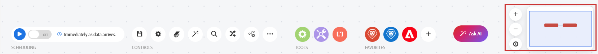
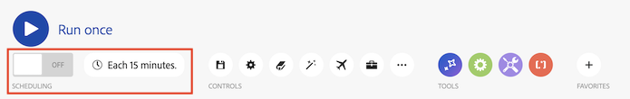

# 시나리오 편집기

시나리오 편집기를 사용하면 시각적 인터페이스에서 시나리오를 만들고 편집할 수 있습니다.

새로운 시나리오 편집기 환경:

클래식 시나리오 편집기 환경

## 액세스 요구 사항

+++ 이 문서의 기능에 대한 액세스 요구 사항을 보려면 확장하십시오.

<table style="table-layout:auto">
 <col> 
 <col> 
 <tbody> 
  <tr> 
   <td role="rowheader">Adobe Workfront 패키지</td> 
   <td> 
모든 Adobe Workfront 워크플로 패키지 및 모든 Adobe Workfront 자동화 및 통합 패키지

Workfront Ultimate

Workfront Prime 및 Select 패키지 및 Workfront Fusion 추가 구매.
 </td> 
  </tr> 
  <tr data-mc-conditions=""> 
   <td role="rowheader">Adobe Workfront 라이선스</td> 
   <td> 
표준

작업 이상
 </td> 
  </tr> 
  <tr> 
   <td role="rowheader">제품</td> 
   <td>
   
조직에 Workfront 자동화 및 통합이 포함되지 않은 Select 또는 Prime Workfront 패키지가 있는 경우 Adobe Workfront Fusion을 구매해야 합니다.</li></ul>
   </td> 
  </tr>
 </tbody> 
</table>

이 테이블의 정보에 대한 자세한 내용은 [설명서의 액세스 요구 사항](/help/workfront-fusion/references/licenses-and-roles/access-level-requirements-in-documentation.md)을 참조하십시오.

+++

## 새로운 경험 및 기존 경험

Workfront Fusion에서 시나리오 편집기를 새 경험으로 전환합니다. 이 전환 중에 클래식 경험과 새 경험을 모두 사용할 수 있으며 언제든지 전환할 수 있습니다. 새 경험을 사용하는 것이 좋습니다.

새 경험에는 다음이 포함됩니다.

* 카드 스타일 모듈, 미니맵 및 확대/축소 컨트롤이 포함된 재설계된 캔버스.
* 찾기 및 바꾸기, 코드 조각, 실행 취소/다시 실행 등을 포함하는 새 시나리오 편집기 컨트롤입니다.
* AI에게 묻기 버튼.
* 카테고리 탐색과 즐겨찾기를 인라인으로 표시하는 기능으로 업데이트된 커넥터 선택기.
* 모양 설정을 따르는 어두운 모드.
* 라우터를 접어 경로를 숨길 수 있습니다.
* 시나리오 실행을 보여주는 패널인 [실시간 추적](/help/workfront-fusion/manage-scenarios/live-trail.md).
* 이제 시나리오 편집기에 빌드된 여러 개발자 도구입니다.
* 시나리오 설정에서 켤 수 있는 임시 디버그 로그.

클래식 경험과 새 경험 간을 전환하려면 다음을 수행하십시오.

1. 시나리오 편집기에서 오른쪽 상단 모서리에서 **[!UICONTROL 새 디자인 시도]** 토글을 찾습니다.
1. 토글을 클릭하여 새 경험으로 전환합니다.
1. 클래식 경험으로 돌아가려면 토글을 다시 클릭합니다.

전환할 때 시나리오가 다시 로드됩니다. 선택은 사용자를 위해 저장되므로 팀 동료가 보는 경험은 변경되지 않습니다. 전환한다고 해서 시나리오 자체가 변경되는 것은 아닙니다.

토글이 표시되지 않으면 조직에서 아직 새 경험을 사용하지 못할 수 있습니다. Workfront Fusion 관리자에게 문의하십시오.

## 새 경험에서 시나리오 편집기 사용(권장)

* [시나리오 편집기를 열고 모듈을 추가합니다.](#open-the-scenario-editor-and-add-a-module)
* [사용 가능한 시나리오 편집기 작업](#available-scenario-editor-actions)

### 시나리오 편집기를 열고 모듈을 추가합니다.

1. 왼쪽 패널에서 **[!UICONTROL 시나리오]** 을 클릭합니다.
1. 자리 표시자 모듈을 클릭하여 앱 및 서비스 목록을 엽니다.
1. 시작할 앱 또는 서비스를 선택합니다.

   * 왼쪽의 패널을 사용하여 카테고리별로 탐색합니다([!UICONTROL 즐겨찾기], [!UICONTROL 모든 앱], [!UICONTROL Adobe Workfront], [!UICONTROL Adobe Firefly Services], [!UICONTROL Adobe Creative 및 콘텐츠], [!UICONTROL Adobe 클라우드 서비스], [!UICONTROL 생성 AI] 또는 [!UICONTROL 기본 제공]).
   * 검색 상자에 검색어를 입력하여 목록을 필터링합니다.
   * 즐겨찾기에 커넥터를 추가하려면 해당 커넥터를 마우스로 가리킨 다음 커넥터 옆에 있는 별 아이콘을 클릭합니다.

   모듈 구성에 대한 자세한 내용은 [모듈 구성](/help/workfront-fusion/create-scenarios/add-modules/configure-a-modules-settings.md)을 참조하십시오.

### 사용 가능한 시나리오 편집기 작업

* [작업 편집](#editing-actions)
* [일정 조정](#scheduling)
* [컨트롤](#controls)
* [도구](#tools)
* [즐겨찾기](#favorites)
* [AI에 묻기](#ask-ai)
* [캔버스 탐색](#canvas-navigation)
* [캔버스 표시](#canvas-display)

#### 작업 편집

이러한 작업은 아래 도구 모음이 아니라 화면 상단에서 사용할 수 있습니다.

| 액션 | 세부 사항 |
| ---------- | ---------- |
| 시나리오 이름 | 시나리오 이름은 화면 왼쪽 상단에 표시됩니다. 시나리오 이름을 변경하려면 이름을 클릭하고 새 이름을 입력합니다. |
| 간결한 보기 | 캔버스의 모듈이 작은 타일로 축소되고 격자가 촘촘해지며 잘리지 않고 긴 모듈 이름이 줄바꿈되는 보기를 전환합니다. 보기를 전환해도 시나리오가 다시 로드되지 않습니다. |
| 피드백 | 새 경험에 대한 피드백을 보냅니다. 이 버튼은 시나리오 편집기의 오른쪽 상단, 간단히 보기 토글 옆에 있습니다. |
|   실행 취소 | 가장 최근 작업, 가장 최근 작업을 먼저 실행 취소합니다. 현재 세션에서만 작업을 실행 취소할 수 있습니다. |
|   다시 실행 | 최근 작업을 다시 실행합니다. 현재 세션에서만 작업을 재실행할 수 있습니다. |
| 기록   | 이 세션의 변경 사항 기록을 봅니다. 모든 세션 변경 내용을 실행 취소할 수도 있습니다. |

#### 일정 조정

| 액션 | 세부 사항 |
| ---------- | ---------- |
| 한 번 실행 | 한 번 실행은 새 디자인에서 아이콘 전용입니다. 아이콘 위로 마우스를 가져가면 **[!UICONTROL 한 번 실행]** 도구 설명을 볼 수 있습니다. 여기에서 시나리오를 테스트하고 활성화하기 전에 예상대로 실행되는지 확인할 수 있습니다 |
| 활성화 토글 | 시나리오를 활성화 또는 비활성화합니다. 시나리오가 활성화되면 해당 스케줄에 따라 실행됩니다. |
| 시나리오 예약 | 기본적으로 폴링 트리거가 있는 시나리오는 15분마다 실행됩니다. 활성화된 시나리오가 실행되는 시기와 빈도를 정의하여 이를 변경할 수 있습니다. 폴링된 Fusion 시나리오는 5분마다 실행되도록 예약할 수 있습니다. 자세한 내용은 [시나리오 예약](/help/workfront-fusion/create-scenarios/config-scenarios-settings/schedule-a-scenario.md)을 참조하십시오. |

#### 컨트롤

이러한 컨트롤 중 일부를 보려면 컨트롤 영역에서 세 점 아이콘을 클릭해야 할 수 있습니다.

| 액션 | 세부 사항 |
| ---------- | ---------- |
| 저장합니다. 

 | 
시나리오를 저장하면 나중에 액세스해야 하는 경우 3점 메뉴 아래에서 새 버전을 사용할 수 있습니다. 다음 시나리오 버전을 만든 후 60일 동안 이전에 저장된 시나리오 버전을 사용할 수 있습니다. 

감사 목적으로 60일 이상 시나리오 버전 기록을 유지하려면 시나리오의 블루프린트를 다른 위치에 저장하고 보관하는 것이 좋습니다.
 |
| 시나리오 설정 

 | 시나리오 설정 패널에는 시나리오에 대한 고급 설정이 포함되어 있습니다. 사용 가능한 설정에 대한 자세한 내용은 [시나리오 설정 구성](/help/workfront-fusion/create-scenarios/config-scenarios-settings/configure-scenario-settings.md)을 참조하십시오. 요청 및 응답 세부 사항은 실행될 때마다 유지되지 않습니다. 시나리오의 일반 실행에 대해 수집하려면 임시 디버그 로그를 켭니다. 자세한 내용은 [임시 디버그 로그](/help/workfront-fusion/create-scenarios/config-scenarios-settings/configure-scenario-settings.md#temporary-debug-logs)를 참조하십시오. |
| 참고 

 | 시나리오에 대해 메모를 합니다. 다른 사용자는 시나리오에 있을 때 이러한 메모를 볼 수 있습니다. 자세한 내용은 [시나리오에 메모 추가](/help/workfront-fusion/create-scenarios/config-scenarios-settings/add-notes-to-scenario.md)를 참조하십시오. |
| 자동 정렬 

 | 시나리오에서 모듈을 자동 정렬합니다. |
| 검색 모듈 

 | 해당 목록에서 모듈을 선택하여 시나리오의 해당 모듈로 이동하거나 검색어를 입력하여 모듈을 찾은 다음 해당 모듈로 가져올 검색 결과를 누릅니다. 모듈 이름, ID, 유형 또는 애플리케이션별로 검색할 수 있습니다. |
| 찾기 및 바꾸기 

 | 
시나리오 모듈에서 변수, 매핑된 값 소스 또는 연결을 검색하고 바꿉니다. 탭을 사용하여 다음을 수행합니다.
<ul><li>전체 시나리오 또는 하나의 모듈에서 매핑된 변수를 바꿉니다.</li><li>한 소스 모듈에서 다른 소스 모듈로 참조를 다시 매핑합니다.</li><li>동일한 앱에서 호환되는 모듈 하나 또는 모두에 연결을 복사합니다.</li></ul>
패널은 변경하기 전에 영향을 받을 모듈을 미리 봅니다. 미리 보기에서 행을 선택하여 캔버스의 해당 모듈로 이동합니다.
 
자세한 내용은 [시나리오에서 변수, 원본 및 연결 찾기 및 바꾸기](/help/workfront-fusion/manage-scenarios/find-and-replace.md)를 참조하십시오.
 |
| 스니펫 

 | 
스니펫은 단위로 저장되는 시나리오 섹션입니다. 모듈을 만들려면 모듈을 선택하고 코드 조각으로 저장합니다. [코드 조각] 패널에서 검색, 태그 지정, 미리 보기, 고정, 정렬 및 드래그하여 놓기 작업을 수행하고 가져올 수 있습니다. 팀이나 조직과 스니펫을 공유하거나 다른 사용자에게 직접 복사본을 보낼 수 있습니다. 공유 스니펫은 자체 탭에 표시됩니다.
 
자세한 내용은 [코드 조각과 함께 시나리오 섹션 저장 및 재사용](/help/workfront-fusion/create-scenarios/add-modules/use-snippets.md)을 참조하십시오.
 |
| 흐름 설명 

 | 움직이는 점이 시나리오를 통해 데이터가 이동하는 방식을 보여 주는 애니메이션을 봅니다. |
| 블루프린트 내보내기 

 | 현재 시나리오의 블루프린트를 내보냅니다. 자세한 내용은 [모듈 또는 시나리오 복사](/help/workfront-fusion/create-scenarios/add-modules/copy-modules-or-scenarios.md)를 참조하십시오. |
| Headless 템플릿으로 내보내기 

 | 시나리오를 Headless 템플릿으로 내보냅니다. |
| 블루프린트 가져오기 

 | 이전에 내보낸 시나리오 블루프린트를 가져옵니다. 자세한 내용은 [모듈 또는 시나리오 복사](/help/workfront-fusion/create-scenarios/add-modules/copy-modules-or-scenarios.md)를 참조하십시오. |
| DevTool 

 | DevTool을 사용하면 시나리오의 모든 수동 실행을 확인하고, 수행된 모든 작업을 검토하고, 수행된 모든 API 호출의 세부 정보를 볼 수 있습니다. 오류를 일으킨 모듈, 작업 또는 단일 응답을 확인하고 해당 지식을 사용하여 시나리오를 구체화할 수 있습니다. 자세한 내용은 [시나리오 디버그](/help/workfront-fusion/manage-scenarios/debug-a-scenario.md)를 참조하십시오. |
| 이전 버전 

 | 이 시나리오의 이전 버전을 봅니다. 자세한 내용은 [시나리오 버전 보기 및 관리](/help/workfront-fusion/manage-scenarios/restore-a-scenario-version.md)를 참조하십시오. |

#### 도구

| 액션 | 세부 사항 |
| ---------- | ---------- |
| 흐름 제어 | 설정을 구성하여 시나리오의 데이터 흐름 방식을 제어합니다. 자세한 내용은 [흐름 제어](/help/workfront-fusion/references/apps-and-modules/tools-and-transformers/flow-control.md)를 참조하십시오. |
| 도구 | 도구 섹션에는 시나리오를 향상시킬 수 있는 몇 가지 유용한 모듈이 포함되어 있습니다. 자세한 내용은 [도구](/help/workfront-fusion/references/apps-and-modules/tools-and-transformers/tools-modules.md)를 참조하세요. |
| 텍스트 구문 분석기 | 텍스트 파서 도구를 사용하여 다른 시나리오 모듈에서 사용할 텍스트를 구문 분석합니다. 자세한 내용은 [텍스트 구문 분석기](/help/workfront-fusion/references/apps-and-modules/tools-and-transformers/text-parser.md)를 참조하십시오. |

#### 즐겨찾기

즐겨찾기 아이콘을 사용하여 자주 사용하는 모듈을 추가할 수 있습니다.

| 액션 | 세부 사항 |
| ---------- | ---------- |
| 즐겨 찾는 커넥터 | 즐겨찾기로 표시한 커넥터가 여기에 표시됩니다. |
| 즐겨찾기 아이콘 추가 | 즐겨찾기 섹션에 추가할 다른 커넥터를 선택하려면 이 아이콘을 클릭하십시오. |
| 오버플로 아이콘 | 도구 모음에 맞출 수 있는 것보다 더 많은 즐겨찾기가 있는 경우 나머지 즐겨찾기에 액세스할 수 있도록 오버플로(점 3개) 아이콘이 표시됩니다. |

#### AI에 묻기

Adobe의 AI 도우미를 열려면 **AI에게 묻기**&#x200B;를 클릭하십시오. 조직의 AI 설정에 따라 이 옵션을 사용하지 못할 수 있습니다.

#### 캔버스 탐색

| 액션 | 세부 사항 |
| ---------- | ---------- |
| 확대/축소 | 캔버스 보기를 확대 또는 축소합니다. |
| 포커스 | 화면에서 전체 시나리오에 맞는 보기로 돌아갑니다. |
| 미니맵 | 전체 시나리오의 축소판 개요를 봅니다. 미니맵은 현재 뷰포트를 표시합니다. 캔버스 안을 클릭하거나 드래그하여 캔버스 안을 이동합니다. |

#### 캔버스 표시

또한 새 캔버스는 작업 시 시나리오가 표시되는 방식을 변경합니다.

| 기능 | 세부 사항 |
| ---------- | ---------- |
| 모듈 카드 | 각 모듈은 앱 아이콘, 모듈 이름, 설명 및 모듈 ID를 표시하는 가로 카드입니다. 라우터는 작은 분기 타일로 표시되고 디렉티브는 작은 악센트 카드로 표시됩니다. |
| 링크 | 모듈 간의 링크는 구부러지고 방향을 표시하는 화살표로 끝납니다. 오류 처리기 링크는 파선입니다. |
| 모듈 상태 | 녹색, 노란색 및 빨간색 지표는 각 모듈의 상태를 보여 줍니다. |
| 확대/축소 세부 정보 | 카드 세부 정보는 확대할 때 표시됩니다. 축소하면 모듈이 아이콘으로 간소화되므로 전체 시나리오를 계속 볼 수 있습니다. |
| 라우터 접기 | 편집 모드에서 라우터를 접어 경로를 숨길 수 있습니다. 자세한 내용은 [라우터 접기](/help/workfront-fusion/create-scenarios/add-modules/router-module.md#fold-a-router)를 참조하십시오. |
| 다크 모드 | 캔버스는 Adobe 환경 설정 아래의 모듈 카드, 링크, 패널, 컨트롤 및 상태 정보를 포함한 어두운 모양 설정을 따릅니다. |
| 오른쪽 패널 | 모듈 설정, 모듈 검사, 모듈 브라우저, 찾기 및 바꾸기, 코드 조각, [라이브 추적](/help/workfront-fusion/manage-scenarios/live-trail.md) 및 요청 및 응답 세부 정보가 캔버스 오른쪽의 같은 패널에서 열립니다. |

## 클래식 경험에서 시나리오 편집기 사용

* [시나리오 편집기를 열고 모듈을 추가합니다(클래식).](#open-the-scenario-editor-and-add-a-module-classic)
* [사용 가능한 시나리오 편집기 작업(클래식)](#available-scenario-editor-actions-classic)

### 시나리오 편집기를 열고 모듈을 추가합니다(클래식).

1. 왼쪽 패널에서 **[!UICONTROL 시나리오]** 을 클릭합니다.
1. 물음표 아이콘 을 클릭한 다음 시작할 앱 또는 서비스를 찾아 클릭합니다. 모듈 구성에 대한 자세한 내용은 [모듈 구성](/help/workfront-fusion/create-scenarios/add-modules/configure-a-modules-settings.md)을 참조하십시오.

### 사용 가능한 시나리오 편집기 작업(클래식)

* [시나리오 실행(클래식)](#run-your-scenario-classic)
* [예약(클래식)](#scheduling-classic)
* [컨트롤(클래식)](#controls-classic)
* [도구(클래식)](#tools-classic)
* [즐겨찾기(클래식)](#favorites-classic)

#### 시나리오 실행(클래식)

| 액션 | 세부 사항 |
|----------|----------|
| 시나리오 테스트 실행 | 활성화하기 전에 시나리오가 예상대로 실행되는지 확인하십시오. 활성화되면 시나리오는 일정에 따라 실행됩니다. 모든 것이 예상대로 실행되지 않으면 [오류 처리 추가](/help/workfront-fusion/create-scenarios/config-error-handling/error-handling.md)를 참조하여 오류를 처리하는 방법을 알아보십시오. |

#### 예약(클래식)

| 액션 | 세부 사항 |
| ---------- | ---------- |
| 시나리오 예약 | 기본적으로 시나리오는 15분마다 실행됩니다. 활성화된 시나리오가 실행되는 시기와 빈도를 정의하여 이를 변경할 수 있습니다. Fusion 시나리오는 5분마다 실행되도록 예약할 수 있습니다. 자세한 내용은 [시나리오 예약](/help/workfront-fusion/create-scenarios/config-scenarios-settings/schedule-a-scenario.md)을 참조하십시오. |

#### 컨트롤(클래식)

이러한 컨트롤 중 일부를 보려면 컨트롤 영역에서 세 점 아이콘을 클릭해야 할 수 있습니다.

| 액션 | 세부 사항 |
| ---------- | ---------- |
| 저장합니다. 

 | 
시나리오를 저장하면 나중에 액세스해야 하는 경우 3점 메뉴 아래에서 새 버전을 사용할 수 있습니다. 다음 시나리오 버전을 만든 후 60일 동안 이전에 저장된 시나리오 버전을 사용할 수 있습니다. 

감사 목적으로 60일 이상 시나리오 버전 기록을 유지하려면 시나리오의 블루프린트를 다른 위치에 저장하고 보관하는 것이 좋습니다.
 |
| 시나리오 설정 

 | 시나리오 설정 패널에는 시나리오에 대한 고급 설정이 포함되어 있습니다. 사용 가능한 설정에 대한 자세한 내용은 [시나리오 설정 구성](/help/workfront-fusion/create-scenarios/config-scenarios-settings/configure-scenario-settings.md)을 참조하십시오. |
| 참고  

 | 시나리오에 대해 메모를 합니다. 다른 사용자는 시나리오에 있을 때 이러한 메모를 볼 수 있습니다. |
| 자동 정렬 

 | 시나리오에서 모듈을 자동 정렬합니다. |
| 검색 모듈 
  
 | 검색어를 입력하여 모듈을 찾은 다음 해당 모듈로 가져올 검색 결과를 클릭합니다. 모듈 이름, ID, 유형 또는 애플리케이션별로 검색할 수 있습니다. |
| 흐름 설명  
 
 | 움직이는 점이 시나리오를 통해 데이터가 이동하는 방식을 보여 주는 애니메이션을 봅니다. |
| DevTool 

 | DevTool을 사용하면 시나리오의 모든 수동 실행을 확인하고, 수행된 모든 작업을 검토하고, 수행된 모든 API 호출의 세부 정보를 볼 수 있습니다. 오류를 일으킨 모듈, 작업 또는 단일 응답을 확인하고 해당 지식을 사용하여 시나리오를 구체화할 수 있습니다. 자세한 내용은 [시나리오 디버그](/help/workfront-fusion/manage-scenarios/debug-a-scenario.md)를 참조하십시오. |
| 블루프린트 내보내기  
 
 | 현재 시나리오의 블루프린트를 내보냅니다. |
| Headless 템플릿으로 내보내기  
 
 | 시나리오를 Headless 템플릿으로 내보냅니다. |
| 블루프린트 가져오기  
 
 | 이전에 내보낸 시나리오 블루프린트를 가져옵니다. |
| 이전 버전  
 
 | 이 시나리오의 이전 버전을 봅니다. |

#### 도구(클래식)

| 액션 | 세부 사항 |
| ---------- | ---------- |
| 흐름 제어 | 설정을 구성하여 데이터가 이동하는 방식을 제어합니다. 자세한 내용은 [흐름 제어](/help/workfront-fusion/references/apps-and-modules/tools-and-transformers/flow-control.md)를 참조하십시오. |
| 도구 | 도구 섹션에는 시나리오를 향상시킬 수 있는 몇 가지 유용한 모듈이 포함되어 있습니다. 자세한 내용은 [도구](/help/workfront-fusion/references/apps-and-modules/tools-and-transformers/tools-modules.md)를 참조하세요. |
| 텍스트 구문 분석기 | 텍스트 파서 도구를 사용하여 다른 시나리오 모듈에서 사용할 텍스트를 구문 분석합니다. 텍스트 파서는 연결할 필요가 없습니다. 자세한 내용은 [텍스트 구문 분석기](/help/workfront-fusion/references/apps-and-modules/tools-and-transformers/text-parser.md)를 참조하십시오. |

#### 즐겨찾기(클래식)

즐겨찾기 아이콘을 사용하여 자주 사용하는 모듈을 추가할 수 있습니다.

